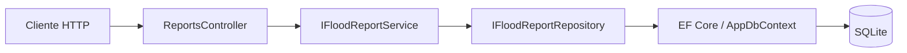

# ALERTASP — API de ocorrências de alagamento

API demonstrativa independente para registrar e consultar relatos de alagamento no município de São Paulo. É a entrega da disciplina **C# Software Development — FIAP Global Solution 2026.2** e implementa a parte C# do projeto CitizenTech ALERTASP.

> Esta versão não consome dados do CGE, GeoSampa, sensores ou previsões. O banco começa vazio, e relatos não representam informação oficial nem monitoramento em tempo real.

**Prazo informado para a Global Solution:** 19/11/2026, às 23h55.

## Equipe

- Enzo Almeida — RM556900
- Gabriel Mello — RM554421
- Guilherme Moreira — RM557290

## Ficha CitizenTech

- **Território:** município de São Paulo; os registros da API identificam via e distrito.
- **Cidadão beneficiado:** pessoa que precisa decidir por onde circular durante chuvas intensas.
- **Problema, em uma frase:** quem circula pela cidade precisa consultar relatos localizados de alagamento com situação, origem e horário observável.
- **Solução desta entrega:** API para registrar relatos, consultá-los por distrito e situação e atualizar o estado informado.
- **ODS:** ODS 11 e 13 orientam a contribuição esperada para resiliência urbana e informação sobre riscos climáticos; ODS 3 é complementar pela relação com segurança. Esta versão não mede impacto e não comprova redução de acidentes.

O problema é uma hipótese de produto. A equipe ainda precisa registrar observação territorial e conversas com pessoas afetadas antes de afirmar que validou a necessidade.

## Escopo, origem e confiabilidade dos dados

A API aceita `Citizen`, `PublicAgency` e `SyntheticDemo` como origem declarada pelo cliente. O campo identifica apenas o que quem enviou o registro informou; ele não autentica a pessoa nem verifica se uma agência realmente produziu o dado. Os status `Reported`, `Confirmed` e `Cleared` também são declarações do sistema, sem integração de verificação externa.

`ObservedAt` informa quando o evento teria sido observado. `CreatedAt` e `UpdatedAt` são horários registrados pela API em UTC. A API não recebe nome, telefone ou outro identificador pessoal. Use somente dados sintéticos ou públicos na demonstração.

### Fontes de contexto e limites de uso

As fontes abaixo orientam o contexto do projeto; **nenhuma é carregada automaticamente pela aplicação**. As páginas e metadados foram consultados em 09/11/2026.

| Fonte | Período, unidade e cobertura | Atualização | Limitações para este projeto |
| --- | --- | --- | --- |
| [CGE — pontos de alagamento](https://www.cgesp.org/v3/alagamentos.jsp) | Painel operacional de pontos monitorados no município; unidade é o ponto registrado e sua classificação de transitabilidade | A página apresenta o estado operacional consultado; não informa garantia de latência para cada atualização | O briefing do projeto informa prioridade de registros de agentes em vias principais e corredores. Ausência de ponto no painel não prova que uma via esteja seca. Não é um inventário completo da cidade nem um feed de sensores. |
| [GeoSampa](https://geosampa.prefeitura.sp.gov.br/) — ocorrências históricas | O briefing do projeto descreve registros de ocorrências desde 2013, em cobertura municipal; unidade é o registro geográfico da ocorrência | O briefing informa atualização mensal por ETL sem sincronismo em tempo real | A camada e o dicionário exatos devem ser conferidos no portal antes de qualquer importação. Histórico não deve ser apresentado como situação atual. |
| [Prefeitura de São Paulo — manutenção e conservação de galerias](https://dados.prefeitura.sp.gov.br/dataset/manutencao-e-conservacao-de-galerias) | CSVs mensais de janeiro a setembro de 2026; registros de serviços, com campos `SERVIÇO`, `MEDIDA` e `TOTAL`; cobertura declarada: Guaianases e Lajeado | Catálogo informa atualização mensal; metadados consultados em 21/10/2026 | Mede intervenções de manutenção, não ocorrências de alagamento. A medida varia por serviço e não permite inferir causalidade ou condição de uma rua específica. A cobertura não representa toda a cidade. |
| [IBGE — São Paulo (município)](https://www.ibge.gov.br/cidades-e-estados/sp/sao-paulo.html) | Estimativa populacional de 2026: **11.911.337 pessoas**, para o município | Estimativa anual; valor consultado em 09/11/2026 | É estimativa municipal, não contagem censitária nem dado de rua. Serve apenas como contexto e não é usado para calcular risco nesta API. |

Fontes oficiais candidatas para pesquisa futura: [INMET — dados históricos](https://portal.inmet.gov.br/dadoshistoricos), [Cemaden — monitoramento](https://www.gov.br/cemaden/pt-br/assuntos/monitoramento), [Defesa Civil de São Paulo](https://prefeitura.sp.gov.br/web/defesa_civil), [SP-Águas](https://www.spaguas.sp.gov.br/site/) e [SP156](https://sp156.prefeitura.sp.gov.br/portal/servicos). Elas não estão integradas nesta entrega; antes de usar dados, registre estação/camada, intervalo de observação, unidade, cobertura, data de consulta e limitações.

## Arquitetura e conceitos da disciplina



- **Domínio:** `FloodReport` protege campos e valida coordenadas, horário observado e transição de situação. `ReportStatus` e `ReportSource` tornam os valores explícitos.
- **Aplicação:** `IFloodReportService` e `IFloodReportRepository` isolam responsabilidades; `FloodReportService` coordena as regras.
- **Persistência:** `EfFloodReportRepository` aplica filtros, ordenação e materialização assíncrona com LINQ/EF Core. Horários são armazenados como Unix milliseconds para que o SQLite consiga ordená-los.
- **API:** `ReportsController` expõe rotas REST e usa DTOs com validação. Injeção de dependência é configurada em `Program.cs`; `ApiExceptionHandler` converte erros de domínio em `ProblemDetails`.
- **Testes:** `Alertasp.Tests` cobre regras do domínio e do serviço com repositório substituto.

## Requisitos

- .NET SDK **10.0.100** (fixado em `global.json`; outro SDK 10.x pode ser usado após revisar o pin).
- SQLite local; o provider é incluído pelo projeto, sem instalar um servidor de banco.
- Acesso ao NuGet no primeiro restore.

## Executar

Na raiz do repositório:

```bash
dotnet restore Alertasp.sln
dotnet run --project src/Alertasp.Api
```

Abra [Swagger](http://localhost:5080/swagger) para explorar os endpoints. O banco é criado em `src/Alertasp.Api/alertasp.db` quando executado pelo comando acima; migrations são aplicadas automaticamente ao iniciar. O SQLite mantém os registros após reiniciar a API. Para parar, use Ctrl+C.

## Endpoints

| Método e rota | Descrição | Respostas principais |
| --- | --- | --- |
| `GET /api/reports?district=Sé&status=Reported` | Lista registros, opcionalmente filtrados por distrito exato e situação; ordena por `ObservedAt` mais recente | `200` |
| `GET /api/reports/{id}` | Consulta por identificador | `200`, `404` |
| `POST /api/reports` | Cria relato, inicialmente em `Reported` | `201`, `400` |
| `PATCH /api/reports/{id}/status` | Altera situação para `Reported`, `Confirmed` ou `Cleared` | `200`, `400`, `404` |
| `GET /health` | Verifica se o processo HTTP está respondendo | `200` |

`POST` exige `roadName`, `district`, latitude entre -90 e 90, longitude entre -180 e 180, `observedAt` em ISO 8601 não futuro e `source` (`Citizen`, `PublicAgency` ou `SyntheticDemo`). Exemplo de corpo:

```json
{
  "roadName": "Via de demonstração",
  "district": "Sé",
  "latitude": -23.5505,
  "longitude": -46.6333,
  "observedAt": "2026-01-15T12:00:00Z",
  "source": "SyntheticDemo"
}
```

O exemplo é fictício, não é ocorrência real. O `201 Created` inclui o ID gerado, situação inicial, origem e horários. Para alterar a situação, envie `{"status":"Confirmed"}` ao endpoint `PATCH`.

Erros de validação e de regra de domínio retornam `400`; identificadores inexistentes retornam `404`; erros inesperados retornam `500` sem expor detalhes internos.

## Persistência e migrations

O provider EF Core SQLite grava em `alertasp.db`. O startup executa `Database.MigrateAsync()`; o repositório inclui a migration inicial. Para criar outra migration após alterar o modelo:

```bash
dotnet tool restore
dotnet build Alertasp.sln
dotnet tool run dotnet-ef migrations add NomeDaAlteracao --project src/Alertasp.Api --no-build
```

## Testes e evidências verificadas

Execute os testes unitários com:

```bash
dotnet test Alertasp.sln
```

Nesta versão, o build concluiu sem warnings e os **4 testes unitários passaram**. O smoke test local também verificou: Swagger `200`; criação `201`; leitura, filtro e mudança de situação `200`; payload inválido `400`; ID inexistente `404`; registro preservado após reinício. A auditoria NuGet não reportou pacotes vulneráveis nas fontes consultadas em 09/11/2026.

Para reproduzir a verificação manual, inicie a API e use os exemplos em Swagger. A evidência de persistência deve mostrar a consulta do mesmo ID antes e depois de reiniciar o processo. A equipe ainda precisa anexar capturas de tela da execução à entrega se a tarefa do Teams as exigir.

## Cobertura da rubrica da página 30

| Critério | Peso | Implementação e evidência | Limite atual |
| --- | ---: | --- | --- |
| POO | 3,0 | Entidade encapsulada, enums e regras; testes de validação | O domínio precisa ser validado com cidadãos e com a linguagem do professor |
| Web API | 2,5 | Rotas REST, DTOs, Swagger, validação e códigos HTTP; smoke test acima | Não há autenticação; não publicar aberta à internet como serviço de produção |
| EF Core + LINQ | 1,5 | SQLite, migration, filtro/ordenação no banco e persistência após reinício | Não importa feeds públicos nem histórico real |
| Async/Await | 1,0 | I/O assíncrona com `CancellationToken` | Cobertura de persistência é smoke test manual; testes unitários isolam o repositório |
| Qualidade do código | 2,0 | DI por interfaces, handler global, README, prompts e testes | Autorização/moderação e limites de uso não fazem parte do protótipo |

## Segurança e limitações

- API sem autenticação ou autorização: qualquer cliente que alcance o servidor pode criar relatos e alterar situações. Restrinja o uso a demonstração local; antes de expor publicamente, implemente autenticação, autorização/moderação e controles contra abuso.
- `PublicAgency` é uma etiqueta enviada pelo cliente, não prova de origem oficial. `Confirmed` também não é confirmação por órgão.
- O banco SQLite é local e começa vazio; não há carga inicial, backup ou serviço remoto configurado.
- Não há interface cidadã neste projeto. Para a atividade de Operating Systems, confirme com o professor se hospedar apenas esta Web API cumpre o requisito de aplicação web.
- Este protótipo não substitui alertas oficiais, Defesa Civil ou orientação de emergência.

## Estrutura do repositório

```text
src/Alertasp.Api/       API, domínio, aplicação, persistência e migrations
tests/Alertasp.Tests/   testes unitários
dotnet-tools.json       pin da ferramenta dotnet-ef
global.json             pin do SDK .NET
prompts.md              registro de uso de IA para revisão da equipe
```

## Validações da equipe antes da entrega

1. Conferir a tarefa do Teams e os conteúdos/ferramentas usados em aula.
2. Registrar observação territorial e conversas com cidadãos sem guardar dados pessoais.
3. Confirmar com o professor se esta Web API satisfaz a parte de Operating Systems.
4. Anexar capturas da API, dos testes e da persistência reiniciada; identificar todos os dados sintéticos.
5. Fazer cada integrante executar e explicar a solução antes da apresentação.
